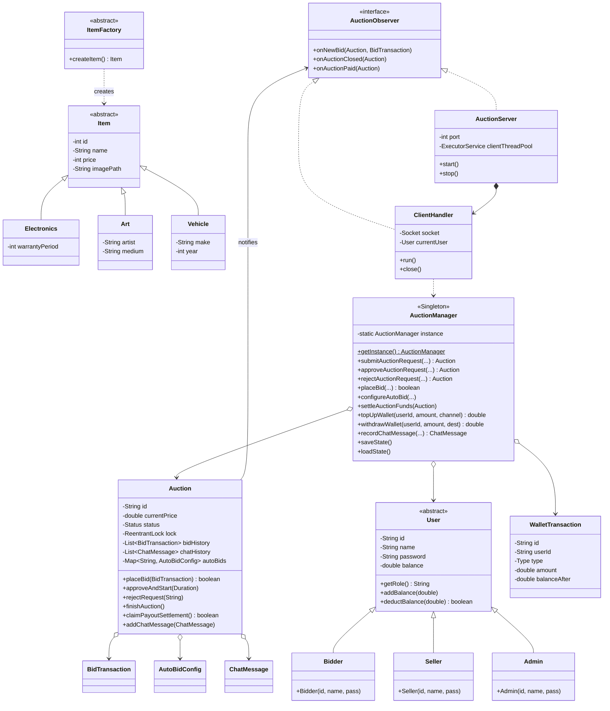
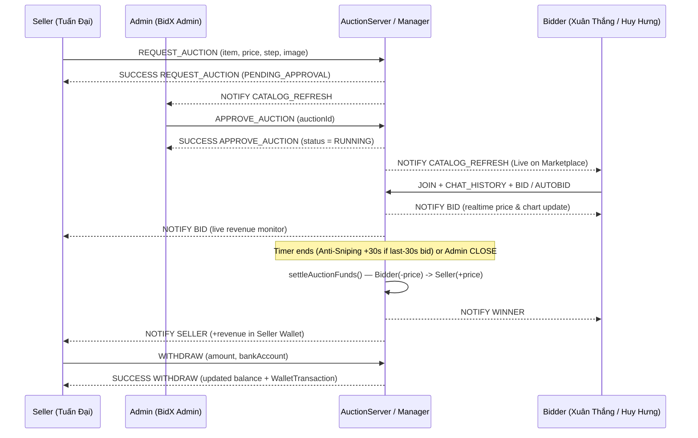

# BidX — Luxury Realtime Online Auction System

[](https://github.com/miraidaihirai/advanced-auction-system/actions/workflows/maven.yml)


**BidX** is a desktop client-server online auction platform built with Java 21, JavaFX 21, and multi-threaded TCP Sockets. The platform implements strict 3-role workflows (**Bidder**, **Seller**, and **Admin**): Sellers submit auction room requests, Admins review and approve/reject listings onto the live marketplace, Bidders compete in realtime with manual bids or PriorityQueue Auto-Bidding protected by Anti-Sniping (+30s), and winning auction proceeds settle automatically into the Seller's wallet with full bank deposit/withdrawal management.

## Team Members

| Member | Role in Demo | Sample Account |
| --- | --- | --- |
| **Tuấn Đại** | Seller | `SELLER-01` |
| **Phạm Trường** | Seller | `SELLER-02` |
| **Xuân Thắng** | Bidder | `BIDDER-01` |
| **Huy Hưng** | Bidder | `BIDDER-02` |
| **BidX Admin** | Admin | `ADMIN-01` |

*(All sample accounts use password `password123`.)*

## Tech Stack

- **Language & Runtime**: Java 21
- **Build & Packaging**: Maven 3.6+, `maven-shade-plugin` (standalone Fat JAR `target/OnlineAuctionApp.jar`)
- **Desktop UI**: JavaFX 21 (FXML, CSS Dark Luxury / Light Ivory theme switcher, 60 FPS Canvas Promo Showcase, SVG vector icons, synthesized audio effects)
- **Networking**: Multi-threaded TCP Socket Server (`AuctionServer`, `ClientHandler`) & `AuctionClient` with structured UTF-8 line protocol (`AuctionProtocol`) and 20s heartbeat `PING`/`PONG`
- **Design Patterns**:
  - **Singleton**: `AuctionManager`
  - **Factory Method**: `ItemFactory` (`ElectronicsFactory`, `ArtFactory`, `VehicleFactory`)
  - **Observer Pattern (over TCP Sockets)**: `AuctionSubject`, `AuctionObserver`, realtime `NOTIFY` broadcasts
- **Concurrency Control**: `ReentrantLock(true)` fair lock on `Auction`, `ConcurrentHashMap`, `CopyOnWriteArrayList`, `PriorityQueue` Auto-Bidding, atomic `synchronized` wallet debit/credit
- **Persistence**: Java Object Serialization (`data/auction_data.ser`) and SQLite JDBC (`sqlite-jdbc`)
- **Testing & CI/CD**: JUnit 5 (128 unit, protocol, workflow & concurrency stress tests), JaCoCo coverage, GitHub Actions

## Installation Requirements

- JDK 21 or newer
- Maven 3.6 or newer
- Git

Check your environment:

```bash
java -version
mvn -version
git --version
```

## Project Structure

```text
.
|-- src/
|   |-- main/
|   |   |-- java/
|   |   |   |-- com/auction/
|   |   |   |   |-- exceptions/    Custom domain exceptions (AuctionClosed, Authentication, InvalidBid)
|   |   |   |   |-- item/          Item hierarchy (Electronics, Art, Vehicle) & ItemFactory
|   |   |   |   |-- manager/       AuctionManager (Singleton state, approval, settlement, wallet, auto-bid)
|   |   |   |   |-- model/         Auction, User, Bidder, Seller, Admin, BidTransaction,
|   |   |   |   |                  AutoBidConfig, WalletTransaction, ChatMessage
|   |   |   |   |-- observer/      AuctionSubject & AuctionObserver interfaces
|   |   |   |   |-- session/       ClientSession (socket lifecycle, per-user isolation, heartbeat)
|   |   |   |   |-- storage/       AuctionDataSnapshot, FileStorageService, TransactionStorageService
|   |   |   |   `-- ui/            JavaFX controllers & components (App, Launcher, ViewManager,
|   |   |   |                      LogIn, Register, Home, AuctionRoom, SellerDashboard, AdminDashboard,
|   |   |   |                      AddProductCard, ProductCard, BidXWalletPanel, BidXEmojiPicker,
|   |   |   |                      BidXPromoShowcase, BidXAnimations, ThemeManager, NotificationManager,
|   |   |   |                      ProductImageService, SoundEffects, SvgIcons, FormatUtils)
|   |   |   `-- network/           AuctionServer, ClientHandler, AuctionClient, AuctionProtocol,
|   |   |                          AuctionDetail, AuctionSummary, UserProfile, WalletTxDTO, ChatMessageDTO
|   |   `-- resources/com/auction/
|   |       |-- css/               bidx-theme.css (Dark Luxury) & bidx-light.css (Light Ivory)
|   |       |-- fxml/              LogIn, Register, Home, AuctionRoom, SellerDashboard,
|   |       |                      AdminDashboard, ProductCard
|   |       `-- images/            BidX 3D brand logo + 22 studio product photographs
|   `-- test/java/                 128 JUnit 5 unit, workflow, persistence & concurrency stress tests
|-- data/                          Persistent serialized state (`auction_data.ser`) & uploaded images
|-- start-server.bat               1-click Windows script to start BidX Socket Server
|-- start-client.bat               1-click Windows script to start BidX JavaFX Client
|-- pom.xml                        Maven build & Fat JAR shade configuration
|-- TASKS.md                       Team task division & progress tracking
`-- README.md
```

## Data Storage & Persistence Configuration

The server automatically restores saved data from `data/auction_data.ser` on startup, or initializes the default 4-member team + Admin and **22 live luxury auctions across 5 categories (`Siêu Xe`, `Đồng hồ cổ`, `Đồ điện tử`, `Nghệ thuật`, `Khác`) + 2 pending Seller requests**.

Auto-save is triggered automatically whenever:
- A user registers.
- A Seller submits an auction request or Admin approves/rejects it.
- A bid is placed (manual or Auto-Bid) or an auction transitions to `FINISHED` / `PAID`.
- A wallet deposit (`TOPUP`), withdrawal (`WITHDRAW`), or automatic auction settlement (`PAYOUT_RECEIVED`) executes.
- A room chat message is sent.

To reset to fresh sample data, delete `data/auction_data.ser` before starting the server.

## Build And Test

Run commands from the repository root:

```bash
# Run full test suite (all 128 unit, role-workflow, persistence & stress tests)
mvn clean test

# Full build, test, Fat JAR packaging, and JaCoCo coverage report
mvn clean verify
```

Packaging generates the standalone Fat JAR at `target/OnlineAuctionApp.jar` (~23 MB) bundling JavaFX 21 runtime, SQLite JDBC driver, stylesheets, and all 23 studio image assets.

## Run Server And Client

Required startup order:

1. Start the **BidX Server** on port `8888`.
2. Launch one or more **BidX Clients** (Bidder, Seller, Admin can connect simultaneously).

### Option 1: 1-Click Scripts (Windows)

- Double-click [start-server.bat](start-server.bat) to start the Socket Server.
- Double-click [start-client.bat](start-client.bat) to launch the JavaFX Client (auto-builds if needed, instant launch via Fat JAR).

### Option 2: Command Line

Terminal 1 — Server (`localhost:8888`):

```bash
java -cp target/OnlineAuctionApp.jar network.AuctionServer
```

Terminal 2 — Client:

```bash
java -jar target/OnlineAuctionApp.jar
```

*(Alternatively: `mvn javafx:run`)*

## Demo Accounts

Sample accounts loaded on initial server startup (default password: `password123`):

| Role | Account ID | Display Name | Initial Balance | Permissions |
| --- | --- | --- | --- | --- |
| **Bidder** | `BIDDER-01` | Xuân Thắng | 500,000,000 đ | Browse approved rooms, place bids, Auto-Bid, Deposit/Withdraw wallet, Live Chat |
| **Bidder** | `BIDDER-02` | Huy Hưng | 500,000,000 đ | Competing bidder, Deposit/Withdraw wallet, Live Chat |
| **Seller** | `SELLER-01` | Tuấn Đại | 0 đ | Submit auction room requests, monitor live rooms, receive automatic payouts & withdraw to bank |
| **Seller** | `SELLER-02` | Phạm Trường | 0 đ | Submit auction room requests, monitor live rooms, receive automatic payouts & withdraw to bank |
| **Admin** | `ADMIN-01` | BidX Admin | 0 đ | Approve/reject Seller requests, supervise/force-close live rooms, audit users & platform cashflow |

Seeded live catalog spans **22 auctions across 5 categories**:
- **Siêu Xe (5)**: Rolls-Royce Phantom VIII Bespoke, Lamborghini Aventador SVJ Giallo, Ferrari SF90 Stradale Rosso Corsa, Mercedes-AMG G63 Matte Black Edition, Porsche 911 Classic Silver.
- **Đồng hồ cổ (4)**: Rolex Cosmograph Daytona 18K Gold, Audemars Piguet Royal Oak Blue Dial, Đồng Hồ Skeleton Tourbillon, Đồng Hồ Cơ Thụy Sĩ Vintage.
- **Đồ điện tử (4)**: MacBook Pro 16 M4 Max Space Black, Tai Nghe Hi-End Focal Utopia Carbon, Máy Ảnh Film Cổ Leica M3, Laptop Dell XPS 15 OLED.
- **Nghệ thuật (4)**: Đàn Grand Piano Steinway & Sons Model D, Tượng Đồng Mạ Vàng Khổng Tước Khai Phú, Tranh Sơn Dầu Hoàng Hôn Biển, Bình Sứ Thanh Hoa Thế Kỷ 19.
- **Khác (5)**: Nhẫn Kim Cương Tự Nhiên 3.5 Carat GIA, Túi Hermès Birkin 30 Da Cá Sấu Cognac, Rượu Whisky Chivas Regal Collector Edition, Nước Hoa Hoàng Gia Oud Amber Extrait, Bộ Cờ Vua Hoàng Gia Đá Cẩm Thạch Ý.

## Key Features

- **Strict 3-Role Workflow (UI + Server Enforced)**:
  - **Seller**: submits room requests (`PENDING_APPROVAL`), uploads or selects studio photos, cannot place bids.
  - **Admin**: approves (`APPROVE_AUCTION` → `RUNNING`) or rejects (`REJECT_AUCTION` with reason), supervises live rooms, audits wallets & cashflow.
  - **Bidder**: browses approved listings, places bids with dynamic scaled quick-bid chips, configures Auto-Bid, pays won auctions.
- **Automatic Settlement & Fintech Wallet Hub**:
  - When a live auction finishes with a winner, the winning amount transfers automatically from Bidder to Seller wallet (idempotent, never double-credited on `PAY`).
  - Full **Deposit (`TOPUP`) & Bank Withdrawal (`WITHDRAW`)** interface for both Bidder and Seller with atomic overdraft protection and live transaction ledger.
- **Realtime Bidding Engine**:
  - Fair `ReentrantLock(true)` on `Auction.placeBid()` eliminating lost updates and race conditions.
  - `PriorityQueue` **Auto-Bidding** and **Anti-Sniping (+30s)** extension on last-30-second bids.
  - Realtime price `LineChart`, Glassmorphism Toast notifications, confetti celebrations, and bid shockwaves.
- **Persistent Live Room Chat & 3D Color Emoji Picker**:
  - Room messages persist on the server (`CHAT_HISTORY`) across logouts, account switches, and server restarts.
  - Messenger-style searchable **48-emoji full-color 3D picker** + floating live room reactions.
- **Luxury Dual-Theme Desktop UI**:
  - Instant **Dark Luxury ↔ Light Ivory** theme switcher (`ThemeManager`) across all 6 screens.
  - 60 FPS animated `BidXPromoShowcase` canvas on Login & Register screens.
  - Multi-angle product gallery (`Toàn cảnh`, `Cận cảnh`, `Góc trái`, `Góc phải`) strictly locked to each item's real studio photo.
- **Testing & Quality**:
  - **128 automated JUnit 5 tests** covering domain models, serialization, protocol, role/wallet/chat workflows (`BidXRoleWorkflowTest`), and concurrency stress (`ServerConcurrencyStressTest`).

## System Architecture

### Class Diagram



### Core Role & Settlement Workflow



## Documentation

- [Project task assignment and roadmap](TASKS.md)
