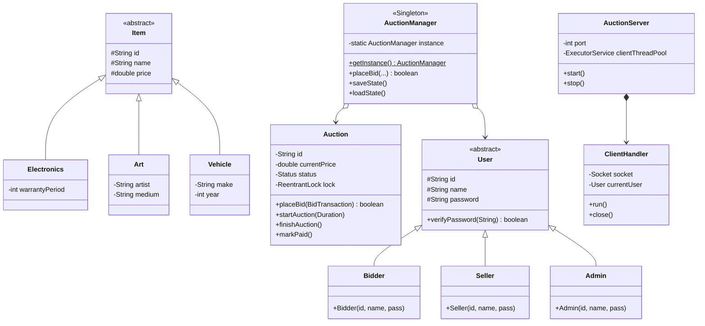

# Online Auction System

[](https://github.com/miraidaihirai/advanced-auction-system/actions/workflows/maven.yml)


Online Auction System is a desktop client-server application for online auctions. The system lets users register and log in, sellers create and manage items, bidders browse auctions and place realtime bids, and admins manage users, auctions, and transaction history. Persistent data is stored via Java Serialization and SQLite.

The project scope focuses on a course-level auction workflow: a JavaFX client connects to a Java TCP socket server, both sides exchange structured protocol messages, the server stores users/items/auctions/bid transactions, and live bidding updates are pushed realtime to clients watching the same auction using the Observer Pattern.

## Tech Stack

- Java 21
- Maven 3.6+ build management
- JavaFX 21 for desktop client UI (FXML, SceneBuilder, CSS)
- Multi-threaded TCP Sockets for realtime client-server communication
- Design Patterns: Singleton (`AuctionManager`), Factory Method (`ItemFactory`), Observer Pattern (`AuctionObserver`)
- Concurrency Control: `ReentrantLock` (fair lock), `ConcurrentHashMap`, `CopyOnWriteArrayList`, cached daemon thread pool
- Data Persistence: Java Object Serialization (`data/auction_data.ser`) and SQLite JDBC
- JUnit 5 & JaCoCo for automated unit tests, stress tests, and coverage measurement
- GitHub Actions CI/CD running automated build and test on push/PR

## Installation Requirements

Install the following tools before running the project:

- JDK 21 or newer
- Maven 3.6 or newer
- Git

Check your environment:

```bash
java -version
mvn -version
git --version
```

## Project Structure

```text
.
|-- src/
|   |-- main/
|   |   |-- java/
|   |   |   |-- com/auction/
|   |   |   |   |-- exceptions/    Custom domain exceptions
|   |   |   |   |-- item/          Item inheritance hierarchy & Factory Method
|   |   |   |   |-- manager/       AuctionManager (Singleton central manager)
|   |   |   |   |-- model/         Domain models (Auction, User, Bidder, Seller, Admin)
|   |   |   |   |-- observer/      Observer pattern interfaces (Subject & Observer)
|   |   |   |   |-- session/       ClientSession management
|   |   |   |   |-- storage/       FileStorageService & TransactionStorageService
|   |   |   |   `-- ui/            JavaFX controllers, ViewManager, App, Launcher
|   |   |   `-- network/           Socket Server, ClientHandler, Protocol, Client
|   |   `-- resources/com/auction/
|   |       |-- fxml/              FXML screen layouts (LogIn, Register, Home, CreateRoom, ...)
|   |       `-- css/               CSS styles
|   `-- test/java/                 JUnit 5 unit tests & Concurrency stress tests
|-- data/                          Persistent serialized storage directory
|-- start-server.bat               1-click batch script to start Socket Server
|-- start-client.bat               1-click batch script to start JavaFX Client
|-- pom.xml                        Maven build configuration
|-- TASKS.md                       Group task division & progress tracking
`-- README.md
```

Main components:

- `network`: Socket Multi-threaded Server on port `8888`, `ClientHandler` with heartbeat timeout, text-based `AuctionProtocol`, and `AuctionClient`.
- `com.auction.model`: OOP core domain models with `ReentrantLock` concurrency protection against lost updates.
- `com.auction.manager`: Singleton `AuctionManager` managing global system state, in-memory caches, and persistence.
- `com.auction.ui`: JavaFX MVC desktop client with screens for login, registration, home auction cards, seller room creation, and product details.

## Data Storage & Persistence Configuration

The server automatically restores previous data if available, or seeds sample users and auctions:

- Persistent file path: `data/auction_data.ser`
- Database: SQLite JDBC (`sqlite-jdbc`) for additional structured records

Auto-save is triggered when:
- A new user registers.
- A new auction is created.
- A bid is successfully placed.
- An auction transitions to `FINISHED` or `PAID`.

To reset to clean sample data, simply remove the `data/auction_data.ser` file before starting the server.

## Build And Test

Run commands from the repository root:

```bash
# Run full test suite (all 64 unit & stress tests)
mvn clean test
```

Build executable standalone Fat JAR:

```bash
mvn clean package -DskipTests
```

This generates `target/OnlineAuctionApp.jar` (~23 MB), which includes the full JavaFX runtime, SQLite driver, and assets.

## Run Server And Client

Required startup order:

1. Start the Server on port `8888`.
2. Start the Client (JavaFX UI).

### Option 1: 1-Click Scripts (Windows)

- Double-click [start-server.bat](start-server.bat) to launch the Socket Server.
- Double-click [start-client.bat](start-client.bat) to launch the JavaFX Client (instant launch via JAR).

### Option 2: Command Line

Terminal 1 - Server:

```bash
java -cp target/classes network.AuctionServer
```

*(Or via Maven on PowerShell: `mvn compile exec:java "-Dexec.mainClass=network.AuctionServer"`)*

The server listens on:

```text
localhost:8888
```

Terminal 2 - Client:

```bash
mvn javafx:run
```

*(Or run standalone JAR: `java -jar target/OnlineAuctionApp.jar`)*

## Demo Accounts

Sample accounts loaded on initial server startup:

| Role | Username | Password | Purpose |
| --- | --- | --- | --- |
| Bidder | `BIDDER-01` | `password123` | Browsing auctions & realtime bidding |
| Bidder | `BIDDER-02` | `password123` | Competing bidder |
| Bidder | `BIDDER-03` | `password123` | Competing bidder |
| Seller | `SELLER-01` | `password123` | Creating rooms & listing products |
| Admin | `ADMIN-01` | `password123` | System management & moderation |

Seeded demo items include `Laptop Dell XPS 15` and `Vintage Antique Vase`.

## Completed Features

- User registration and role-based authentication for `BIDDER`, `SELLER`, and `ADMIN`.
- Multi-threaded Socket Server handling concurrent client sessions using a cached daemon thread pool.
- Concurrency protection: `Auction.placeBid()` controlled by `ReentrantLock(true)` (fair lock) preventing lost updates and race conditions.
- Observer Pattern over Sockets: realtime push notifications for `NOTIFY BID`, `NOTIFY CLOSED`, `NOTIFY WINNER`, `NOTIFY SELLER`, and `NOTIFY PAID`.
- Heartbeat and timeout handling with `AtomicBoolean` cleanup ensuring zero socket/thread leaks.
- Factory Method Pattern for item instantiation (`ElectronicsFactory`, `ArtFactory`, `VehicleFactory`).
- Desktop JavaFX UI screens (MVC): Login, Register, Home card catalog, Seller Create Room, Product Details.
- Data persistence via Object Serialization and SQLite.
- Concurrency stress tests with 10 concurrent threads bidding simultaneously and 20 rapid disconnects (`ServerConcurrencyStressTest.java`).
- Automated CI/CD workflow with GitHub Actions.

## System Architecture



## Documentation

- [Project task assignment and roadmap](TASKS.md)

## Report And Demo Video (Updating...)