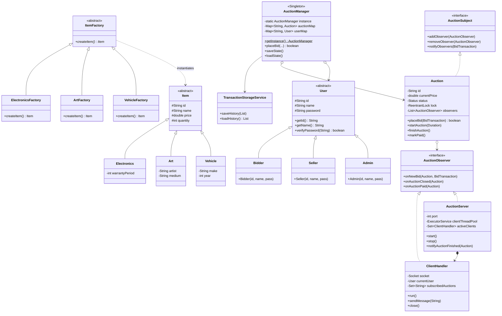
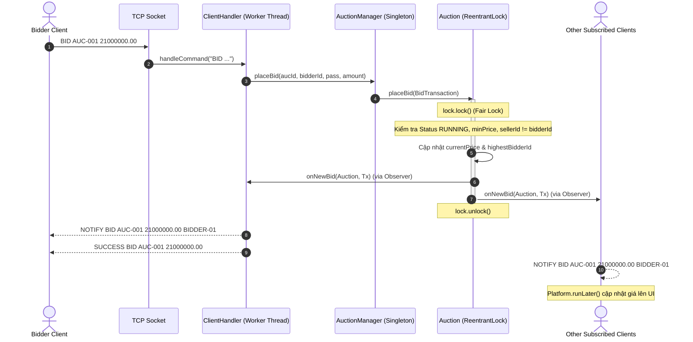
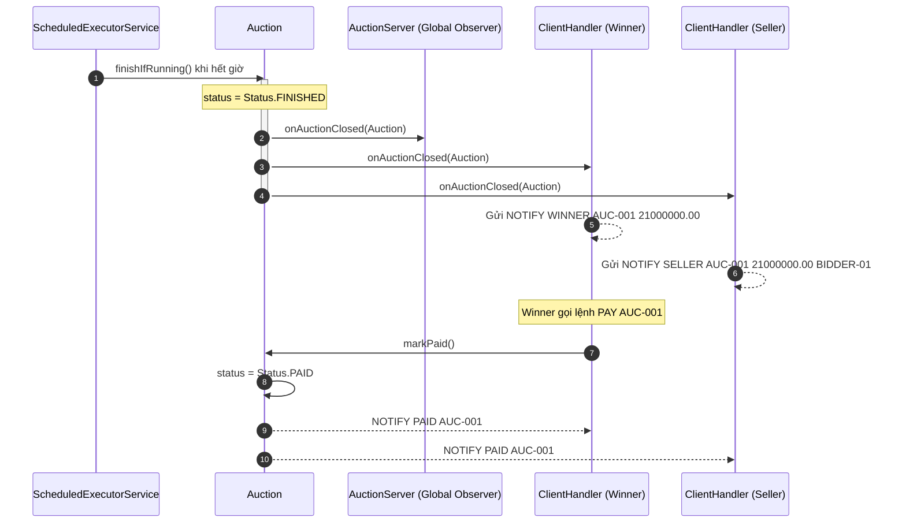

# 🚀 Online Auction System (Hệ thống Đấu giá Trực tuyến)

Bài tập lớn môn **Lập trình nâng cao (LTNC)**  
Công nghệ: **Java 21**, **JavaFX**, **Maven**, **JUnit 5**, **Socket Client-Server**, **Design Patterns & Concurrency**.

> Xem chi tiết kế hoạch và phân công nhiệm vụ: [TASKS.md](TASKS.md)

---

## 📌 1. Tổng quan Kiến trúc Hệ thống

Hệ thống hoạt động theo mô hình **Client-Server đa luồng (Multi-threaded Socket)** kết hợp kiến trúc **MVC (Model - View - Controller)** và cơ chế **Observer Pattern** để đồng bộ dữ liệu realtime.

```
+-------------------------------------------------------------+
|                      JAVAFX CLIENT                          |
|  +------------------+  Platform.runLater()  +------------+  |
|  | Controller / UI  | <-------------------  |  Client    |  |
|  |  (FXML Screens)  | ------------------->  |  Listener  |  |
|  +------------------+                       +------------+  |
+---------------------------------------------------|---------+
                                                    | TCP Socket
                                                    v
+-------------------------------------------------------------+
|                      SOCKET SERVER                          |
|  +-------------------------------------------------------+  |
|  | AuctionServer (Port 8888, Cached Thread Pool)         |  |
|  |                                                       |  |
|  |  [ClientHandler 1]   [ClientHandler 2]   [Worker N]   |  |
|  +-------------------------------------------------------+  |
|                           | (Observer Pattern)              |
|                           v                                 |
|  +-------------------------------------------------------+  |
|  | AuctionManager (Singleton)                            |  |
|  |  - ConcurrentHashMap: Users, Auctions                 |  |
|  |  - Auction: ReentrantLock (Fair Lock)                 |  |
|  |  - Serialization / Transaction Storage Service        |  |
|  +-------------------------------------------------------+  |
+-------------------------------------------------------------+
```

---

## 📊 2. Sơ đồ UML Hệ thống

### 2.1. Class Diagram (Kiến trúc Hướng đối tượng & Design Patterns)



---

### 2.2. Sequence Diagram: Luồng Đặt giá Realtime (Realtime Bidding Flow)



---

### 2.3. Sequence Diagram: Luồng Kết thúc Phiên & Thanh toán (Finish & Pay)



---

## 🛠️ 3. Hướng dẫn Cài đặt & Chạy Dự án

### Yêu cầu Môi trường
- **Java Development Kit (JDK):** Version **21** trở lên.
- **Apache Maven:** Version **≥ 3.6**.

### Các câu lệnh thực thi

| Mục đích | Câu lệnh Maven | Ghi chú |
|---|---|---|
| **Chạy toàn bộ 64 Unit & Stress Tests** | `mvn clean test` | 100% test pass, kiểm tra đa luồng, heartbeat, serialization |
| **Khởi động Socket Server** | `mvn compile exec:java -Dexec.mainClass="network.AuctionServer"` | Server lắng nghe tại cổng `8888`, tự nạp dữ liệu cũ |
| **Khởi động Giao diện JavaFX** | `mvn javafx:run` | Mở ứng dụng đồ họa JavaFX |
| **Chạy bản Demo Console** | `mvn exec:java` | Demo đầy đủ kịch bản OOP và Concurrency trong console |
| **Kiểm tra Checkstyle** | `mvn checkstyle:check` | Tuân thủ Google Java Style Guide |

---

## 💻 4. Điểm cốt lõi cho Tuấn Đại (Leader) khi Bảo vệ Đồ án

Khi thuyết trình bảo vệ đồ án, Leader Tuấn Đại phụ trách các nội dung trọng tâm sau:

### 4.1. Kiến trúc Tổng thể & Socket Server Đa luồng
- **Mô hình Client-Server:** Socket Server chạy ở chế độ Multi-threaded, sử dụng `Executors.newCachedThreadPool` sinh các daemon worker thread có định danh rõ ràng (`socket-client-worker-N`), tự động co giãn theo số lượng client kết nối.
- **Quản lý Session & Heartbeat:** Mỗi client được quản lý bởi một `ClientHandler`. Server thiết lập cơ chế **Heartbeat (ping/pong)** kết hợp socket `soTimeout` để phát hiện client ngắt kết nối đột ngột hoặc rớt mạng. Khi ngắt kết nối, phương thức `close()` sử dụng `AtomicBoolean` đảm bảo dọn dẹp tài nguyên đúng 1 lần: tự động hủy đăng ký observer tại các phiên, giải phóng socket handle và gỡ bỏ session khỏi server (cam kết **Zero Socket / Thread Leak**).

### 4.2. Xử lý Đồng thời (Concurrency Control)
- **Chống Race Condition & Lost Update:** Thay vì dùng `synchronized` khối lớn gây thắt cổ chai, `Auction.placeBid()` sử dụng `ReentrantLock(true)` (fair lock) để bảo đảm thứ tự FIFO cho các lượt bid cạnh tranh cùng mili-giây.
- **Bộ sưu tập an toàn luồng (Concurrent Collections):**
  - `ConcurrentHashMap` trong `AuctionManager` quản lý hàng triệu phiên đấu giá và người dùng mà không bị lock toàn bộ bảng băm.
  - `CopyOnWriteArrayList` lưu trữ danh sách Observers trong từng `Auction`, cho phép vừa duyệt gửi thông báo realtime vừa thêm/xóa client mà không gây `ConcurrentModificationException`.
  - `AtomicLong` trong `AuctionManager` sinh mã Transaction ID duy nhất với tốc độ cực cao không cần khóa.
- **Stress-Test đã xác thực:** Đã viết bộ kiểm thử chịu tải `ServerConcurrencyStressTest.java` mô phỏng 10 client cùng bắn lệnh bid dồn dập vào 1 phiên trong cùng 1 thời điểm và 20 client ngắt socket đột ngột; toàn bộ dữ liệu giữ vững tính toàn vẹn 100%.

### 4.3. Ứng dụng Các Mẫu Thiết kế (Design Patterns)
1. **Singleton Pattern:** `AuctionManager.getInstance()` bảo đảm chỉ có một thực thể quản trị duy nhất trên toàn Server, kiểm soát truy cập tập trung vào tài nguyên đấu giá và người dùng.
2. **Factory Method Pattern:** `ItemFactory` với các lớp con `ElectronicsFactory`, `ArtFactory`, `VehicleFactory` giúp mở rộng danh mục sản phẩm linh hoạt mà không sửa đổi mã nguồn xử lý phiên đấu giá (tuân thủ nguyên lý Open/Closed Principle - SOLID).
3. **Observer Pattern:** `AuctionSubject` và `AuctionObserver`. Mỗi `ClientHandler` là một observer lắng nghe sự kiện của các phiên đấu giá mà client tham gia. Khi có bid mới, phiên tự động kích hoạt callback bắn bản tin `NOTIFY BID` tức thời qua Socket về giao diện JavaFX.

---

## 👥 5. Phân công Trách nhiệm Nhóm

- **Vũ Tuấn Đại (Leader):** Kiến trúc tổng thể, Socket Server đa luồng, Concurrency Control, Realtime Observer, Stress Test, Tài liệu & Sơ đồ UML.
- **Xuân Thắng:** Serialization / Deserialization, Quản lý lịch sử giao dịch (Persistence), Nghiệp vụ kiểm tra quyền, CI/CD GitHub Actions & Checkstyle.
- **Huy Hưng:** Thiết kế giao diện FXML (MVC), Điều hướng 5 màn hình JavaFX, Video demo kịch bản đấu giá realtime.
- **Trường:** Cầu nối dữ liệu Socket - JavaFX (`Platform.runLater()`), Hệ thống Dialog/Alert thông báo lỗi, Báo cáo kiểm thử & Tinh chỉnh CSS.
